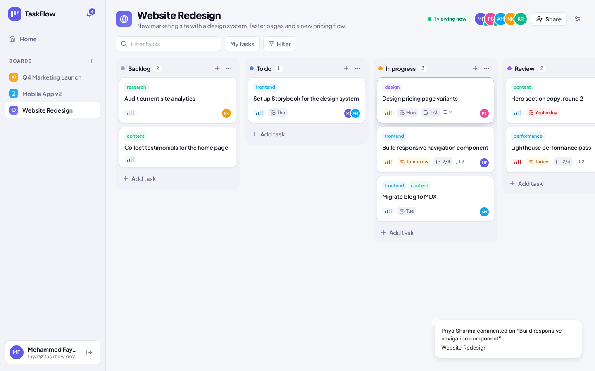
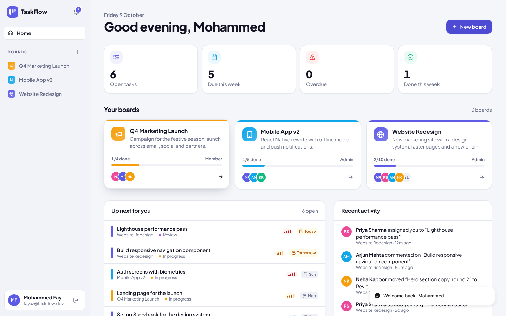
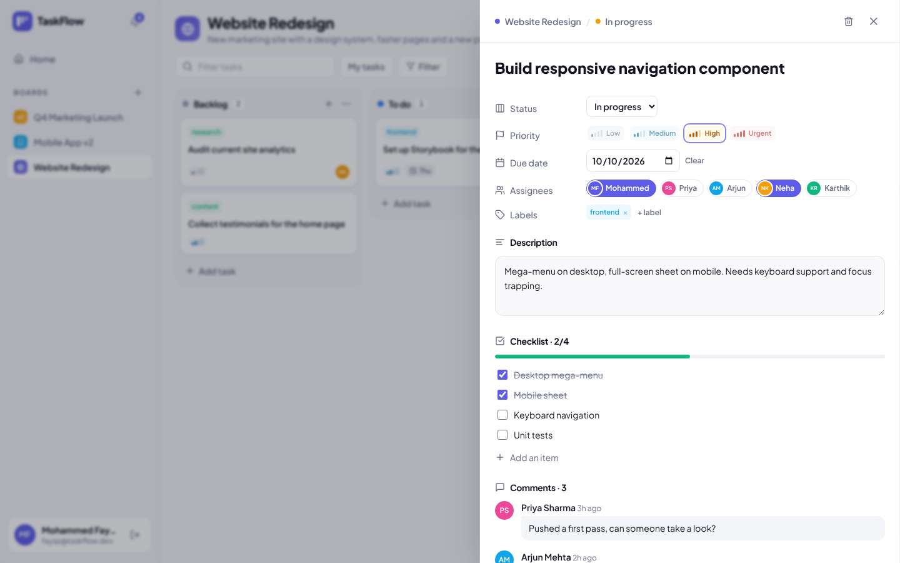
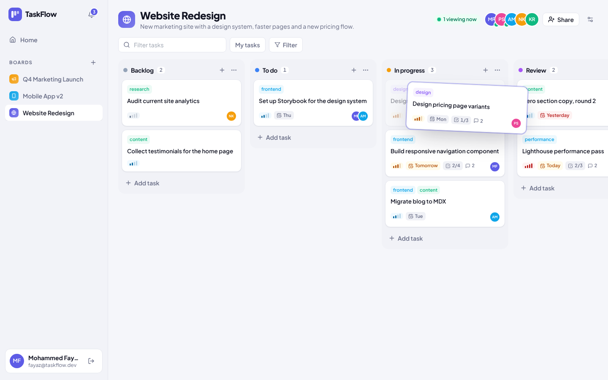
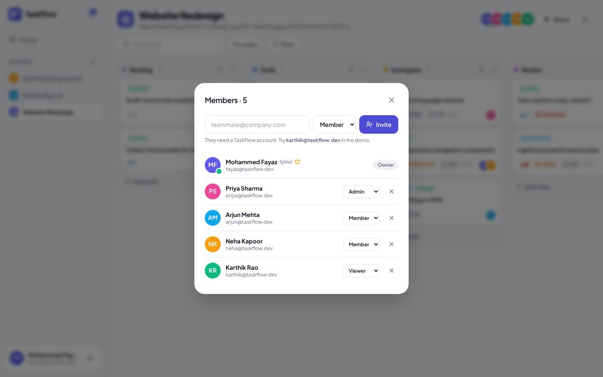
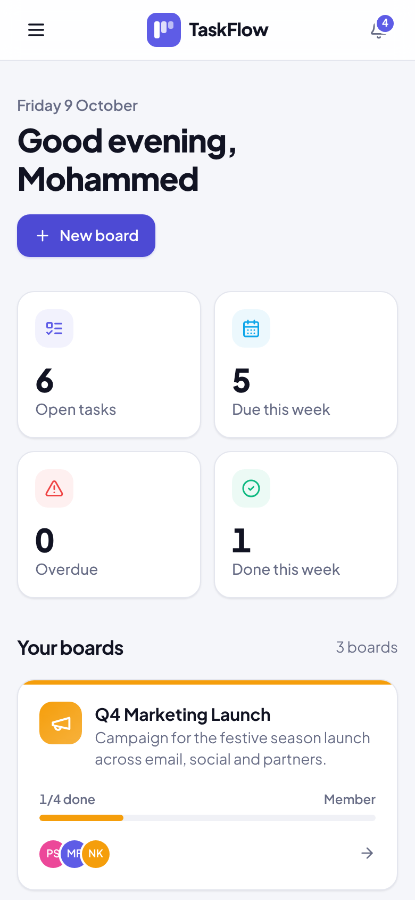
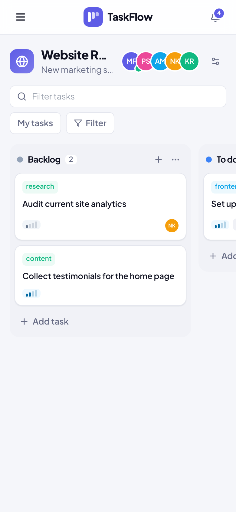

<div align="center">

# ⚡ TaskFlow

**Real-time collaborative project management** — Kanban boards with drag and drop, team roles, deadlines, checklists, comments and live notifications over WebSockets.




</div>

## Features

**Boards and tasks**
- Kanban boards with custom columns; a "done" column stamps tasks as completed
- Drag and drop across and within columns (mouse, touch and keyboard) with optimistic updates
- Tasks with priority, due dates, assignees, labels, checklists and a description
- Filter by text, assignee or priority, plus a one-click "My tasks" view

**Real-time collaboration (Socket.io)**
- Every change — new tasks, moves, edits, comments, column changes — appears instantly for everyone on the board
- Live presence: see who is looking at the board right now
- In-app notifications when you are assigned, someone comments on your task, or your task moves

**Teams and roles**
- Invite teammates by email as **admin**, **member** or **viewer**
- Viewers can read and comment; members edit tasks; admins manage columns, members and settings
- Non-members get a 404 for a board, so board IDs can't be probed

**Engineering**
- TypeScript on both sides, strict mode
- Fractional ordering: moving a card updates one document; a column is only renumbered when two neighbours collide
- Socket rooms per board and per user, authenticated with the same JWT as the REST API
- Zod validation, centralised error handling, Helmet
- Integration tests for roles, ordering and notifications (Vitest + Supertest), GitHub Actions CI

## Screenshots

| Home | Task details |
| --- | --- |
|  |  |
| **Dragging a card** | **Members and roles** |
|  |  |

<p align="center"> </p>

## Tech stack

| Layer | Tools |
| --- | --- |
| Frontend | React 18, TypeScript, Vite, TanStack Query, dnd-kit, Socket.io client, React Router, Tailwind CSS, Framer Motion |
| Backend | Node.js, Express, Socket.io, Mongoose, Zod, JSON Web Tokens, bcrypt |
| Database | MongoDB |
| Testing & CI | Vitest, Supertest, GitHub Actions |

## Getting started

**Requirements:** Node.js 20+ and MongoDB (local, Docker or Atlas).

```bash
git clone https://github.com/mdfayaz25/taskflow.git
cd taskflow
npm install

docker compose up -d                 # or point MONGO_URI at Atlas
cp server/.env.example server/.env
npm run seed                         # 5 teammates, 3 boards, tasks and comments
npm run dev                          # API + sockets on :5000, app on :5173
```

Sign in with any demo account (password `Demo@1234`): `fayaz@taskflow.dev`, `priya@taskflow.dev`, `arjun@taskflow.dev`, `neha@taskflow.dev`, `karthik@taskflow.dev`.

> **Try the real-time part:** open the app in two browsers (or one normal and one private window), sign in as two different people, open the same board and drag a card.

### Scripts

| Command | What it does |
| --- | --- |
| `npm run dev` | Runs the API and the React app together |
| `npm run seed` | Resets the database with sample data |
| `npm test` | Runs the API integration tests |
| `npm run typecheck` | Type-checks server and client |
| `npm run build` then `npm start` | Production build; Express serves the React app |

## How real-time works

```
Browser A ──PATCH /api/tasks/:id/move──▶ Express ──save──▶ MongoDB
                                            │
                                            └─ io.to("board:<id>").emit("tasks:moved")
                                                        │
Browser B ◀──────────── socket event ───────────────────┘  → React Query cache updated in place
```

- On connect, each socket authenticates with the JWT and joins `user:<id>` (for notifications).
- Opening a board emits `board:join`; the server checks membership before adding the socket to `board:<id>`.
- Events: `task:upserted`, `tasks:moved`, `task:deleted`, `comment:added`, `board:updated`, `board:viewers`, `notification:new`.

## API overview

| Method | Endpoint | Role needed |
| --- | --- | --- |
| `GET` `POST` | `/api/boards` | Signed in |
| `GET` | `/api/boards/:id` | Viewer |
| `PATCH` `DELETE` | `/api/boards/:id` | Admin |
| `POST` `PATCH` `DELETE` | `/api/boards/:id/members[/:userId]` | Admin |
| `POST` `PATCH` `DELETE` | `/api/boards/:id/columns[/:columnId]` | Admin |
| `POST` | `/api/tasks` | Member |
| `PATCH` | `/api/tasks/:id`, `/api/tasks/:id/move` | Member |
| `GET` `POST` | `/api/tasks/:id/comments` | Viewer |
| `GET` | `/api/tasks/mine` | Signed in |
| `GET` `POST` | `/api/notifications`, `/api/notifications/read-all` | Signed in |

## License

MIT © [Mohammed Fayaz](https://github.com/mdfayaz25)
